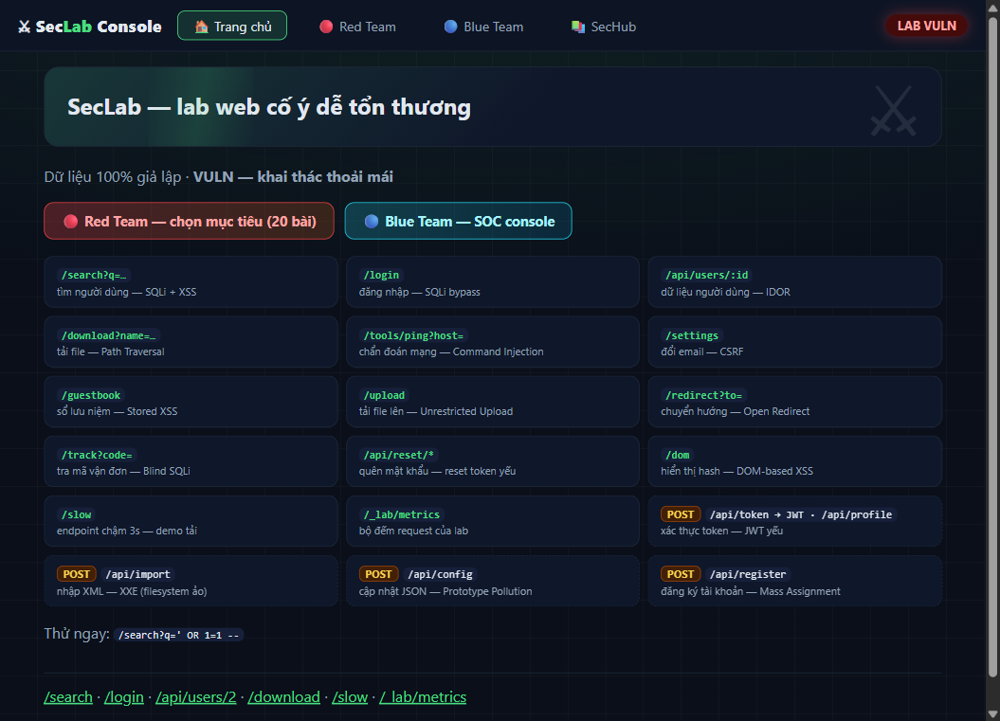
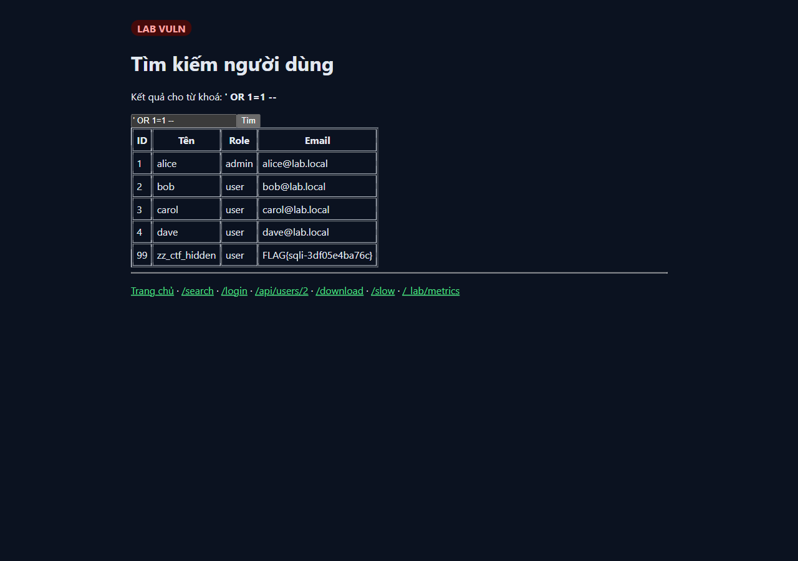
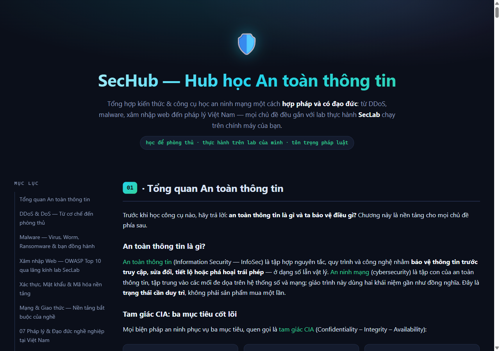
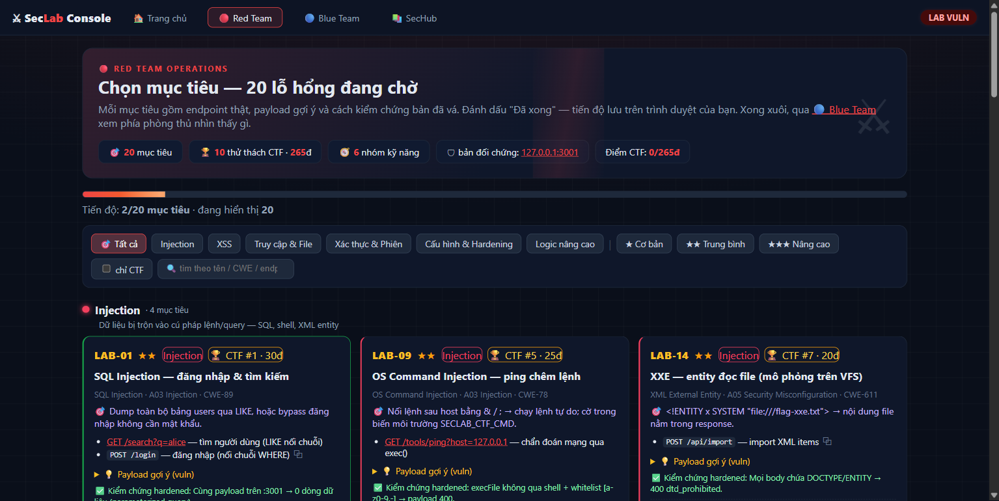
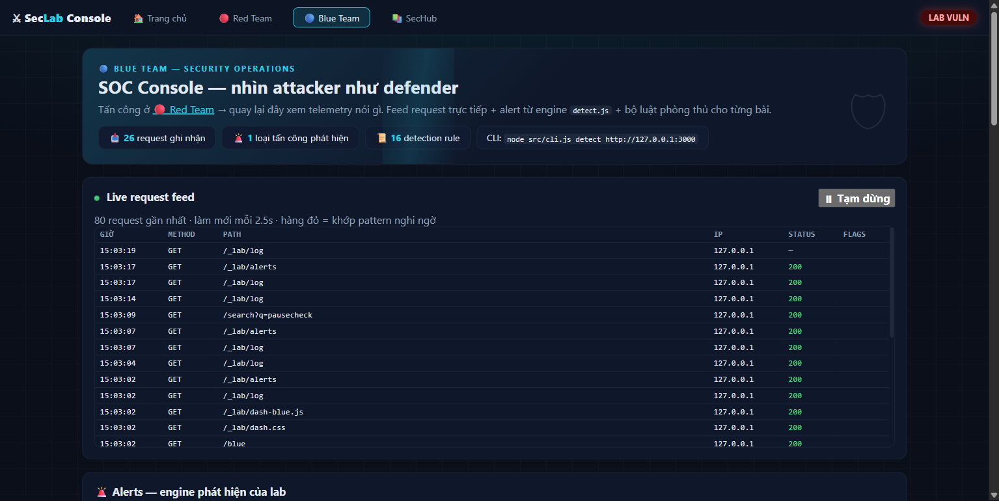
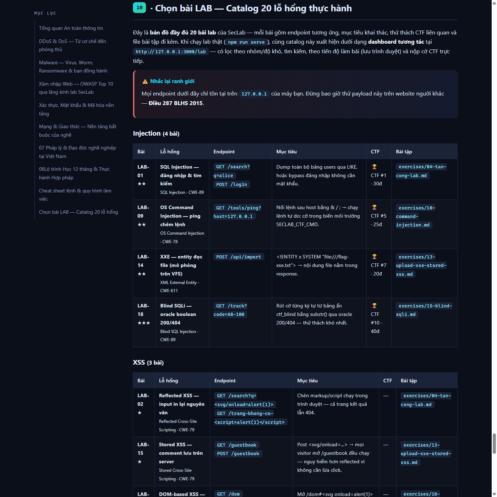

# SecLab — Bộ công cụ HỌC an toàn thông tin (lab cục bộ)

[](https://github.com/JasonTM17/Security_Lab_Study/actions/workflows/ci.yml)
[](LICENSE)
[](package.json)
[](#kết-quả-đã-được-xác-minh-chạy-thật-trên-máy-này)
[](CONTRIBUTING.md)

> ⚠️ **Công cụ này KHÔNG phải và KHÔNG THỂ là công cụ DDoS tấn công website trên
> Internet.** Mọi lệnh chủ động bị chặn cứng với mục tiêu public (xem
> [docs/01-phap-ly-va-dao-duc.md](docs/01-phap-ly-va-dao-duc.md) — Điều 287 BLHS 2015).
> Nó là **môi trường thực hành hợp pháp**: bạn tấn công lab của chính mình, đo,
> vá và chứng minh đã vá — đúng quy trình nghề an toàn thông tin.

## Bạn có gì trong tay

| Thành phần | File | Làm gì |
|---|---|---|
| 🔴 **Lab web có 20 lỗ hổng chủ đích** | `src/lab/app.js` | SQLi (error-based + **blind**), XSS (reflected + stored + **DOM-based**), IDOR, Path Traversal, Command Injection, CSRF, JWT yếu, Open Redirect, Unrestricted Upload, XXE (mô phỏng trên VFS), **Prototype Pollution, Mass Assignment, Reset Token đoán được**, directory listing, thiếu headers/rate limit/authz — kiểu DVWA/Juice Shop thu nhỏ |
| 🔴 **Red Team dashboard** | `GET /lab` + `src/lab/dashboard.js` | Catalog tương tác 20 bài: lọc theo 6 nhóm/độ khó/chỉ-CTF, tìm kiếm, mở endpoint trực tiếp, payload gợi ý copy-được, tiến độ lưu trình duyệt, **nộp cờ CTF ngay trong trang** — cùng dữ liệu sinh catalog cho SecHub |
| 🔵 **Blue Team SOC console** | `GET /blue` + `GET /_lab/alerts` | Quan sát attacker như defender: live request feed (mỗi 2.5s, hàng nghi ngờ tô đỏ theo pattern), alert cards từ engine `detect.js`, 16 detection rule + giới hạn, 20 thẻ phòng thủ theo bài lab — học luồng **tấn công → quan sát → so sánh hardened** |
| 🏆 **Chế độ CTF** | `challenge` + `/_lab/challenges` | **10 thử thách 265 điểm**, cờ `FLAG{...}` sinh ngẫu nhiên THEO PHIÊN lab — tự khai thác để lấy, server xác minh bằng timing-safe compare; hardened từ chối nhận cờ |
| 🕵️ **Blue-team detect** | `detect` + `/_lab/log` | phân tích log request: SQLi/XSS/traversal/cmdinj/XXE/open-redirect/upload/JWT-probe/brute-force/dò admin/scanner/proto-pollution/mass-assign/blind-sqli/reset-abuse — mỗi phát hiện kèm biện pháp phòng thủ |
| 🔐 **Codec — bộ mã hoá nền tảng** | `codec` | b64/hex/url/rot13/hash, mỗi kết quả kèm bài học |
| 🎫 **Công cụ JWT** | `jwt` + `src/modules/jwttool.js` | decode/forge/verify/crack token — crack HS256 bằng từ điển, forge alg=none (chạy cục bộ, không mạng) |
| 🟢 **Bản đã vá (hardened) để so sánh** | cùng file, chế độ `--hardened` | Parameterized query, escape output, execFile + whitelist, CSRF token, JWT verify chặt, rate limit, timeout, limit_conn |
| 🔍 **Recon** | `src/modules/recon.js` | Headers, fingerprint, port scan (cục bộ), robots.txt |
| 🧪 **Quét lỗ hổng** | `src/modules/vulnscan.js` | **19 nhóm check** (CMDI/CSRF/JWT/OpenRedirect/Upload/XXE/StoredXSS + **PROTO/MASS/BLIND/RESET/DOMXSS**), mỗi finding kèm bằng chứng + cách vá |
| 🌊 **Mô phỏng tải (HTTP flood)** | `src/modules/loadtest.js` | pacing theo rps, đo p50–p99, thống kê 429 — chỉ trên lab |
| 🚶 **Flow test (luồng người dùng thật)** | `src/modules/flowload.js` | chuỗi bước trang chủ → tìm kiếm → chi tiết, think-time + ramp-up, N virtual user, đo p95 TỪNG BƯỚC — chỉ trên lab |
| 🕷 **Polite scraper (cào web công khai)** | `src/modules/scraper.js` | tôn trọng robots.txt + crawl-delay, rate-limit, chỉ cùng-origin — module DUY NHẤT cho phép web public |
| 🐌 **Mô phỏng slowloris** | `src/modules/slowloris.js` | kết nối "nửa request", đo server có cắt không |
| 🛡 **Module phòng thủ** | `src/defense/` | Token-bucket rate limiter + security headers + CSRF token (synchronizer) |
| 📄 **Báo cáo** | `src/modules/report.js` | Xuất `.md` + `.html` vào `reports/` (crawl xuất `.md` + `.json`) |
| 📚 **Tài liệu & 17 bài thực hành** | `docs/`, `exercises/` | Pháp lý → kiến trúc → DoS/DDoS → cheat sheet → scraping → E2E → **bản đồ OWASP Top 10** → detection engineering → case study thực chiến → bài tập có tiêu chí hoàn thành |
| 🔑 **Lời giải & solver đa ngôn ngữ** | `solutions/` | Writeup 10 CTF (recon → root cause → exploit → vá), solver **chạy được** bằng Node.js/Python/Bash/PowerShell (verify 10/10 · 265đ), answer key 17 bài tập — cùng guard `--i-own-this-target` |
| ✅ **149 unit/integration tests** | `tests/` | Bao gồm test GUARD chặn public + test đối chứng 20 lỗ hổng vuln/hardened |
| ⚙️ **CI workflow** | `.github/workflows/ci.yml` | GitHub Actions: unit + E2E trên Node 22/24 × Ubuntu + Windows |

Không có dependency ngoài nào — chỉ dùng thư viện chuẩn Node ≥ 22.5
(bao gồm `node:sqlite`).

## Bắt đầu trong 60 giây

```bash
npm test                       # 149/149 pass (unit + integration)
npm run e2e                    # 64/64 E2E HTTP — tự khởi động 3 server, tự đối chứng vuln/hardened
npm run serve                  # lab CỐ Ý DỄ TỔN THƯƠNG → http://127.0.0.1:3000
# mở http://127.0.0.1:3000/lab — 🔴 Red Team: chọn bài (20 bài · lọc · tiến độ · nộp cờ CTF)
# mở http://127.0.0.1:3000/blue — 🔵 Blue Team: SOC console (live feed · alerts · rules · phòng thủ)
```

Terminal khác:

```bash
node src/cli.js recon http://127.0.0.1:3000
node src/cli.js scan  http://127.0.0.1:3000     # báo cáo vào reports/
node src/cli.js loadtest http://127.0.0.1:3000 --path=slow --rps 40 --duration 8
node src/cli.js flowtest http://127.0.0.1:3000 --users=6 --iterations=8
```

Cào dữ liệu web **công khai** một cách lịch sự (hợp pháp — như một trình duyệt):

```bash
node src/cli.js crawl --url=https://example.com --max-pages=20 --depth=2
node src/cli.js crawl --url=http://127.0.0.1:3000 --i-own-this-target   # tập trên lab
```

Rồi chạy bản đã vá để so sánh:

```bash
npm run serve:hardened -- --port 3001
node src/cli.js scan http://127.0.0.1:3001      # High 0 · Medium 0
```

Lộ trình học đầy đủ: `node src/cli.js labs` (17 bài trong `exercises/`).
Người đứng lớp đọc thêm [docs/09-huong-dan-giang-day.md](docs/09-huong-dan-giang-day.md)
— giáo án 6 buổi, kịch bản demo, lỗi thường gặp, gợi ý chấm điểm.
Phe phòng thủ đọc thêm [docs/10-detection-engineering.md](docs/10-detection-engineering.md)
(viết detection rule từ `/_lab/log`) và [docs/11-case-study-thuc-chien.md](docs/11-case-study-thuc-chien.md)
(3 case study tấn công → phát hiện → vá → chứng minh).

Đồ chơi JWT (bài LAB-11 — hoạt động cục bộ, không cần mạng):

```bash
node src/cli.js jwt decode <token>
node src/cli.js jwt crack  <token>                            # từ điển secret yếu
node src/cli.js jwt forge --payload='{"sub":"ctfsvc"}' --alg=none
```

## Hình ảnh thực tế

| Lab `vuln` — 20 endpoint lỗ hổng chủ đích | Khai thác SQLi `' OR 1=1 --` trả về toàn bảng |
|---|---|
|  |  |

| SecHub — giáo trình 10 chuyên mục | 🔴 Red Team dashboard `/lab` |
|---|---|
|  |  |

| 🔵 Blue Team SOC console `/blue` — live feed + alerts + detection rules |
|---|
|  |

## SecHub — Hub học an toàn thông tin

Trang tổng hợp **10 chuyên mục học tập** (tổng quan ATTT · DDoS · malware · xâm nhập
web OWASP · xác thực & mã hóa · mạng & giao thức · pháp lý Việt Nam · lộ trình 12 tháng
· cheat sheet · **catalog 20 bài LAB**) kèm mục lục tự sinh, giao diện tối, gắn trực
tiếp với lab và lệnh của SecLab:

```bash
node src/cli.js hub            # mở http://127.0.0.1:4000 (chỉ truy cập được từ máy này)
```

Nội dung nằm trong `hub/` (shell + 9 section HTML + bản ghép `hub/index.html` đọc
được cả khi mở trực tiếp file). Server tĩnh có chống path-traversal (đã test 403).
Sửa một chuyên mục xong, ghép lại bằng: `node scripts/assemble-hub.js`.

**SecHub Online:** bản `hub/index.html` được deploy lên GitHub Pages bởi
`.github/workflows/pages.yml` — bật ở repo Settings → Pages → Source = "GitHub
Actions", sau đó mọi push đụng `hub/` sẽ tự publish tại
`https://jasontm17.github.io/Security_Lab_Study/`.

| Chuyên mục 10 — catalog 20 bài LAB trên Pages (tự sinh từ `src/lab/dashboard.js`) |
|---|
|  |

Nội dung hub đã qua quy trình **độc giả độc lập**: 10 nhận xét (2 High — gồm sai
khung hình phạt Điều 287 "12–15 năm" → sửa đúng "7–12 năm"; tên tội danh Điều
287/288 thống nhất; tham chiếu chéo sai; lệnh thiếu cờ; thuật ngữ chưa giải thích)
đã được xử lý toàn bộ trước khi ghép.

## Đã kiểm chứng bằng trình duyệt thật (Playwright + browser-use)

- Trang lab render đúng, click/link/textbox hoạt động thật; thử payload SQLi
  `' OR 1=1 --` trên **bản hardened qua trình duyệt** → trả 0 dòng dữ liệu.
- Phát hiện & sửa: webviewviewer ép dark mode khiến trang nền sáng biến thành
  "chữ tàng hình" — lab chuyển sang dark-native (đọc tốt ở mọi trình duyệt).
- Server hub: file hợp lệ 200, path traversal `../package.json` → **403**.

## Mô hình an toàn của công cụ

1. **Guard cứng** (`src/guard.js`): mục tiêu public → từ chối kèm căn cứ pháp lý;
   dải riêng → bắt buộc cờ `--i-own-this-target`; loopback → tự do.
   Áp dụng cho mọi lệnh **tạo tải/kiểm thử xâm nhập** (recon/scan/loadtest/flowtest/slowloris).
2. **Guard ngược chiều cho scraper** (`src/modules/scraper.js`): module duy nhất
   cho phép web **public** — vì fetch trang công khai lịch sự là hợp pháp; nhưng
   mặc định chặn loopback/dải riêng (cần `--i-own-this-target` khi tập trên lab),
   tôn trọng robots.txt, sàn delay 300ms, cap 200 trang / độ sâu 5, chỉ cùng-origin.
3. **Bind cứng 127.0.0.1**: lab không bao giờ lắng nghe trên `0.0.0.0`.
4. **Dữ liệu ảo**: CSDL là SQLite in-memory; "hệ thống file" của bài traversal
   là object trong RAM — không chạm đĩa thật.

> Git Bash trên Windows: dùng `--path=slow` (dấu `=`) thay vì `--path /slow`
> để tránh MSYS tự biến thành đường dẫn Windows.

## Cấu trúc thư mục

```
├── src/
│   ├── cli.js            # CLI chính
│   ├── guard.js          # ⛔ lớp chặn ủy quyền (quan trọng nhất)
│   ├── db.js             # SQLite thật + fallback, cặp hàm vuln/safe
│   ├── lab/              # app.js (2 chế độ) + jwtx.js + serve.js
│   ├── modules/          # recon, vulnscan, loadtest, flowload, slowloris, scraper, detect, challenge, codec, jwttool, report, http
│   ├── defense/          # ratelimiter (token bucket), headers, csrf
│   └── utils/color.js
├── tests/                # 149 test + e2e.mjs 64 check
├── solutions/            # 🔑 writeup 10 CTF + solver Node/Py/Bash/PS1 + answer key 17 bài
├── docs/                 # pháp lý · kiến trúc · DoS/DDoS · cheat sheet · scraping · OWASP map · detection eng · case study · instructor guide · images/
├── exercises/            # 17 bài thực hành có tiêu chí hoàn thành
├── reports/              # output quét (gitignored)
└── .github/workflows/ci.yml
```

## Kết quả đã được xác minh (chạy thật trên máy này)

- `node --test` → **149/149 pass** (bao gồm "chặn mục tiêu public kể cả khi có cờ" + test đối chứng 20 lỗ hổng).
- `npm run e2e` → **64/64 PASS** — đối chứng cặp vuln/hardened cho cả LAB-09..20 mới (nhóm H).
- Scan bản vuln → **High 14, Medium 5** (SQLi, XSS×2, IDOR, path nhạy cảm, CMDI, CSRF, JWT, Upload, XXE, proto-pollution, mass-assign, blind-sqli, reset-token, DOM-XSS + headers/cookie/redirect/rate-limit), báo cáo xuất ra `reports/`.
- Scan bản hardened → **High 0, Medium 0**.
- Loadtest `/slow` 40 rps: vuln ≈13 req/s với p95 ≈ 3000 ms; hardened ≈80% request
  nhận 429 nhưng p50 ≈ vài ms.
- Flowtest 6 user × 8 vòng trên hardened: 144 request, 113×429 (rate limiter chặn
  dồn dập) nhưng không có request nào timeout — thấy ngay bước nào nghẽn đầu.
- Crawl lab hardened: robots.txt được đọc và tôn trọng, 6 trang có tiêu đề + latency,
  báo cáo ghi vào `reports/crawl-*.md|.json`.
- Slowloris 100 socket: vuln giữ 100/100; hardened cắt sớm 90, giữ 10, vẫn 200 cho
  request hợp lệ.
- `recon http://8.8.8.8` → bị từ chối với thông điệp pháp lý.
- CTF đầy đủ 7 cờ: cmdinj đọc được `SECLAB_CTF_CMD` qua env, JWT alg=none/secret123 forge được token `ctfsvc`, XXE đọc `flag-xxe.txt` từ VFS ảo.

## Lưu ý pháp lý & đạo đức (tóm tắt)

Kiểm thử hệ thống không thuộc sở hữu của bạn mà không có giấy phép bằng văn bản
là **bất hợp pháp** — tại Việt Nam thuộc Điều 287 Bộ luật Hình sự 2015 (khung
cao nhất nhiều năm tù), ngoài ra còn Luật An ninh mạng 2018. Học an toàn thông
tin đúng nghĩa là: lab của mình → đo lường → vá lỗi → báo cáo. SecLab được thiết
kế để chỉ cho phép bạn làm đúng điều đó.

## Đóng góp & báo lỗi

- Muốn đóng góp lab/bài tập mới → đọc [CONTRIBUTING.md](CONTRIBUTING.md).
- Lỗi bảo mật của chính công cụ (phá guard, đụng đĩa thật…) → đọc [SECURITY.md](SECURITY.md).
- Mọi lỗ hổng trong bản `vuln` là **chủ đích** — đừng báo như bug.

Giấy phép: [MIT](LICENSE).
